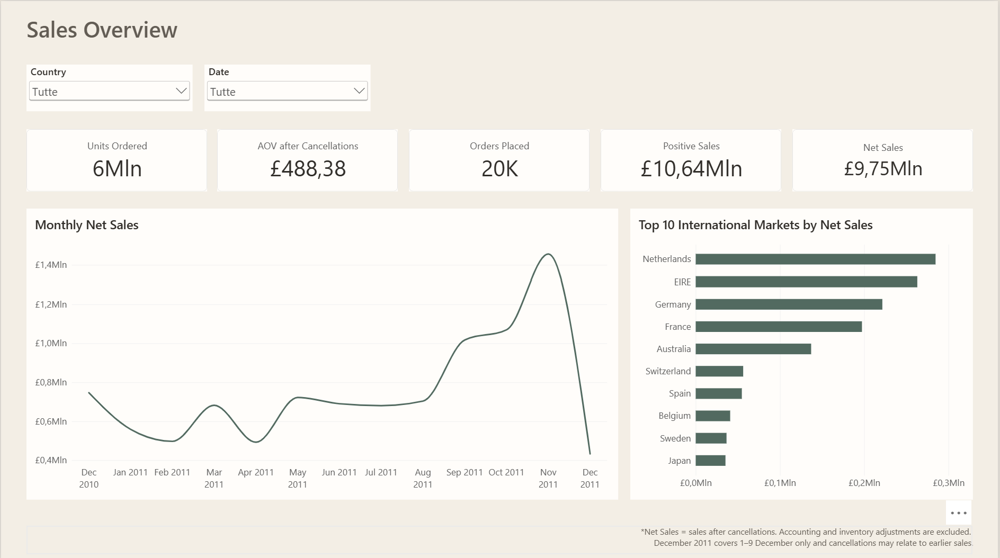
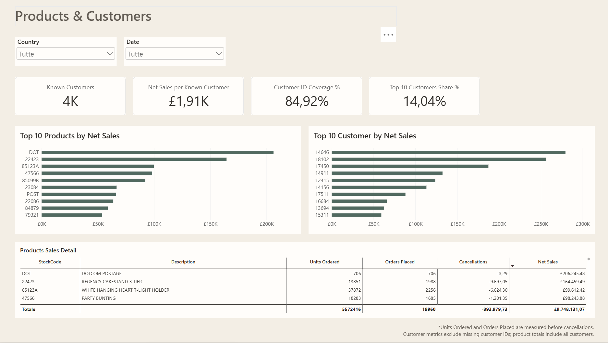
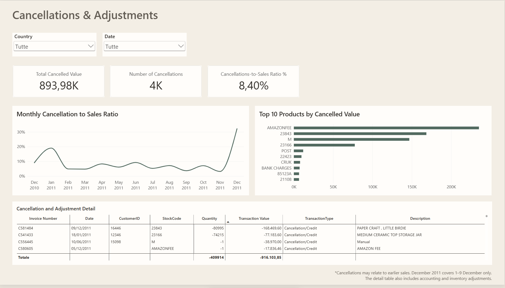

# Online Retail Performance Analysis
### MySQL and Power BI

An analysis of sales performance, customer concentration and cancellations for a UK online retailer, covering December 2010 to December 2011.

### Sales Overview

### Products and Customers

### Cancellations and Adjustments

## Main Findings

### 1. Cancellations materially change the sales picture

Sales before cancellations totalled £10.64 million. Recorded cancellations reduced this by £893,980, leaving £9.75 million in Net Sales.
Cancellation value represented 8.4% of sales before cancellations. Excluding these entries would therefore overstate performance.

One particularly significant transaction involved 80,995 units of PAPER CRAFT, LITTLE BIRDIE, worth £168,469.60. A matching cancellation was recorded 12 minutes later, offsetting the entire sale.
This example informed the decision to use Net Sales, rather than positive sales alone, for performance charts and rankings.

### 2. Sales were heavily concentrated in the UK

The United Kingdom generated £8.19 million, approximately 84.0% of Net Sales.
The report separates international market rankings from the UK to make differences between smaller markets visible.

### 3. Net Sales strengthened towards the end of 2011

Net Sales increased from £704k in August 2011 to £1.46m in November. The available data does not establish whether this reflects business growth or seasonal demand.

December 2011 includes only the first nine days. Its lower total should not be interpreted as a full-month decline.

### 4. Product rankings need to distinguish merchandise from charges

REGENCY CAKESTAND 3 TIER generated £164,459 in Net Sales, making it the highest-value merchandise stock code in the analysis.

DOTCOM POSTAGE generated £206,245, but represents a delivery charge rather than a product. Including it without explanation would distort a merchandise ranking.

This highlights the importance of reviewing transaction meaning alongside numerical rankings.

### 5. Customer concentration and identification affect interpretation

The ten highest-value identified customers generated approximately 14.0% of total Net Sales.

Around 84.9% of Net Sales could be associated with a customer ID. The remaining 15.1% was retained in overall sales totals but could not be attributed to individual customers.

## Business Implications

- Monitor cancellations alongside sales to avoid overstating performance.
- Assess dependence on the UK while exploring the characteristics of established international markets.
- Review stock and fulfilment capacity ahead of the observed autumn sales peak.
- Separate merchandise, delivery charges and adjustments in product reporting.
- Improve customer identification to strengthen customer analysis.

## Method

MySQL was used to convert data types, inspect anomalies, remove exact duplicates and create a reporting view. Power BI was used for modelling, DAX measures and interactive reporting.

The original dataset contained 541,909 rows. Removing 5,268 exact duplicate copies left 536,641 records. Treating identical rows as repeated records is a project assumption.

Net Sales is defined as positive sales less recorded cancellations. Accounting and inventory adjustments are analysed separately.

Cancellations are recorded on their transaction dates and are not systematically matched to original sales. The report does not establish payment or delivery status, and no profit analysis is possible without cost data.

## Data Source

[UCI Online Retail Dataset](https://archive.ics.uci.edu/dataset/352/online+retail)

Chen, D. (2015). Online Retail [Dataset].
UCI Machine Learning Repository.
https://doi.org/10.24432/C5BW33

License: CC BY 4.0.
